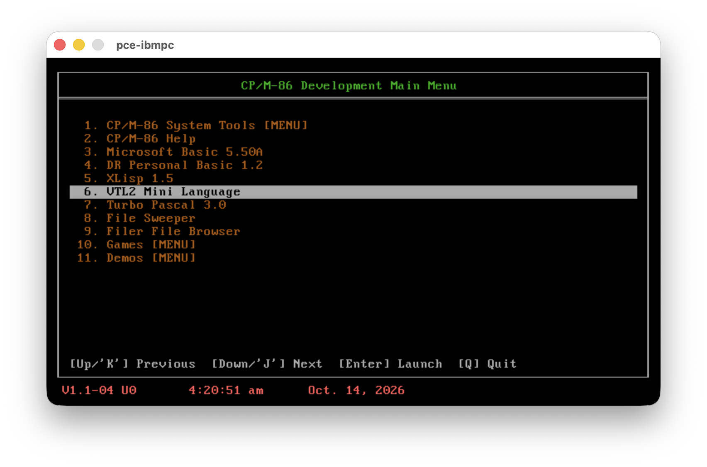
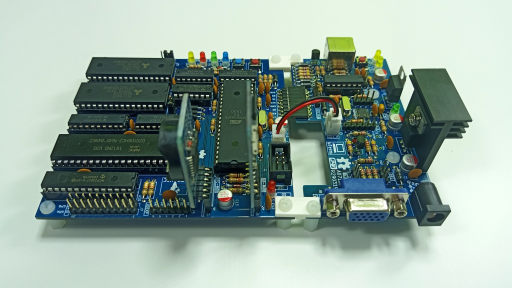
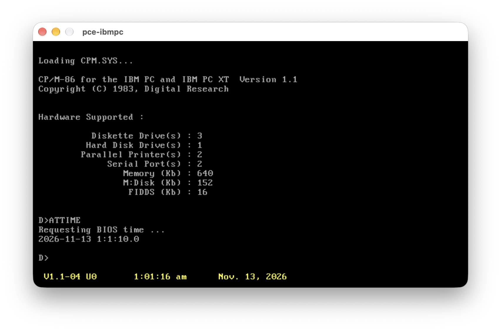
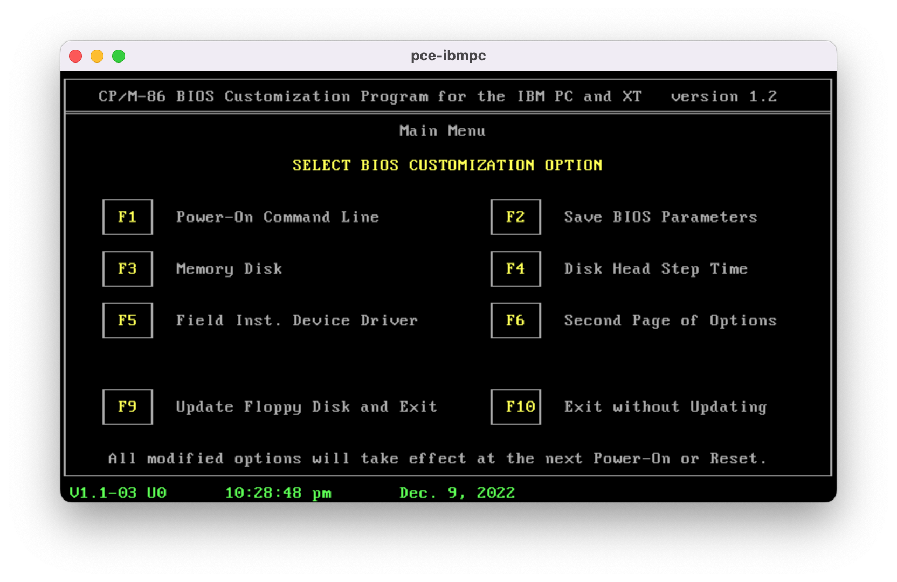
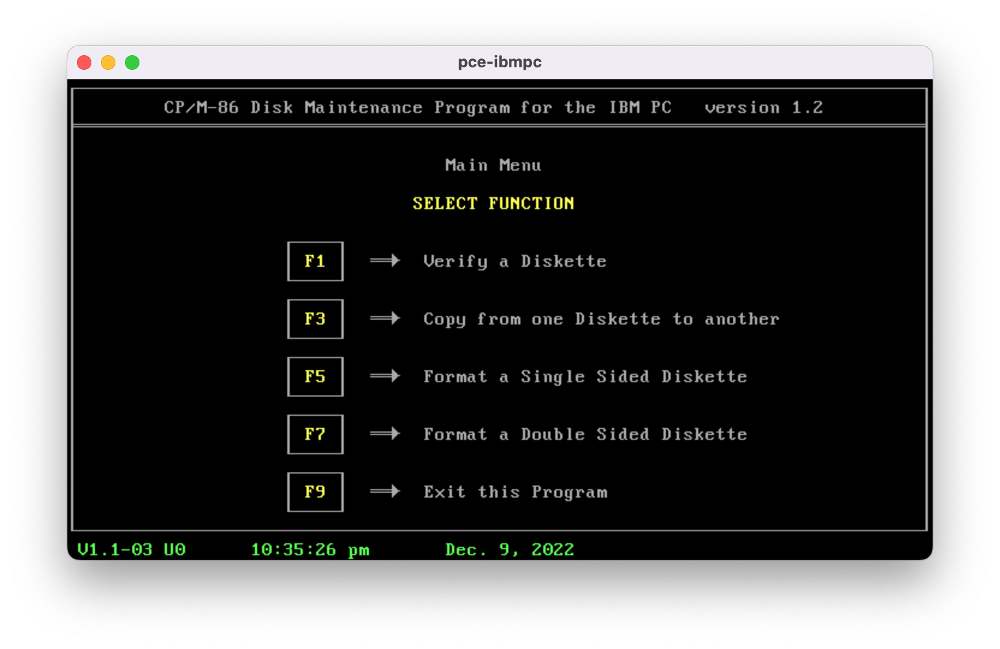

# CP/M-86 Kernel and Base Tools

CP/M-86 1.1 kernel and commands for IBM PC/XT, emulators, V20 MBC and the AD8088 Card for Apple II. The project contains a full distribution of CP/M-86 1.1, patched, y2k compliant, enhanced and complete, for PC and PC XT built entirely from source.

It is build with [cpm86-crossdev](https://github.com/tsupplis/cpm86-crossdev).

## Kernels

### Kernel source sets

The PC kernel was recovered by disassembly. Maintained and experimental builds have separate baselines; they intentionally differ from the frozen reference.

| Output | CCP / BDOS / BIOS sources | Purpose |
| --- | --- | --- |
| `cpm.sys` | `ccp.a86`, `bdos.a86`, `pcbios.a86` | Maintained PC kernel |
| `cpmorg.sys` | `ccporg.a86`, `bdosorg.a86`, `pcbioorg.a86` | Frozen patched reference; do not edit |
| `cpmexp.sys` | `ccpexp.a86`, `bdosexp.a86`, `pcbioexp.a86` | Experimental PC kernel |
| `mbcv20.sys` | `ccp.a86`, `bdos.a86`, `mbcv20.a86` | V20 MBC, 8088 mode; segment `0040h`; ([source](https://hackaday.io/project/170924-v20-mbc-a-v20-8088-8080-cpu-homebrew-computer)) |
| `mbc816.sys` | `ccp.a86`, `bdos.a86`, `mbc816.a86` | V20 MBC, mixed 8080/8088 mode; segment `0040h`; ([source](https://hackaday.io/project/170924-v20-mbc-a-v20-8088-8080-cpu-homebrew-computer)) |
| `ad88.sys` | `ccp.a86`, `bdos.a86`, `ad88bios.a86` | AD8088 / Apple II; segment `4000h`; ([source](https://github.com/ushicow/ad8088cpm)) |

### Kernel patches

Patch history is in `patching/`; addresses and reserved-space use are in [mapping.md](mapping.md). Local edits are marked `Ts:`. Public entry points and existing system-data addresses are preserved.

| DR patch | Area | Fix |
| --- | --- | --- |
| 01 | Chain (`MCHAIN`) | Stop at the terminating zero; store the command length correctly |
| 06 | Search (`DRCOPY`) | Copy directory records to the user's DMA segment |
| 07 | Version (`BDOSB`) | Clear `BH` on return |
| 08 | Load (`MLOADP`, `MLOADK`) | Preserve the FCB offset and segment; prevent memory corruption |
| 10 | Dispatch (`BDOSBC`) | Return `FFFFh` for invalid function numbers |
| 11 | Load (`MLOADQ`) | Return `FFFFh` when absolute memory is denied |
| 13 | Internal calls (`PATCH13`) | Preserve `AFWFCB` and `FLOMOD` during loads |
| 15 | Load (`PATCH15`) | Honour absolute data-group bases |

These patches are present in the frozen and maintained BDOS sets. The original PC/XT release lacks patch 15 and places patches 08, 10 and 11 at different addresses. Its free-memory patch at `0A3Ah` is absent here.

| Other change | Effect |
| --- | --- |
| CCP `DIRPAT` | Two-column `DIR` on screens narrower than 60 columns |
| CCP submit handling | Use the current drive; prevent key presses from cancelling submit files |
| Reference IDs | Align OEM, version and serial bytes with the recovered reference |
| Console abort | Match the XT call order in `CONSTA` |
| User 0 system files | Remove the erroneous S1 test in `SRDRNZ`; retain instruction offsets with NOPs |
| PC BIOS | AT interrupt-vector fix, year-2000 fix and 80-column colour fallback |
| Maintained PC hard disks | Support partitions up to 31.5 MiB; see [HDMAINT compatibility notes](commands/hdmaint/README.md) |

Tool patches: 03 GENDEF, 04–05 ED, 09 PIP and 12 SUBMIT. Patches 02 (LDCOPY) and 14 (sample BIOS TRACK.A86) are outside this kernel.

## Tools

Original/patched binaries live in `base/`; source builds live in `commands/`. Imported CCP/M commands are adapted for this kernel's BDOS 2.2 interface (`BH=0`).

| Tool | Binary (`base/`) | Source (`commands/`) |
| --- | --- | --- |
| `asm86` | Original | CCP/M-86 3.1 port |
| `assign` | Original | Reconstructed CP/M-86 source |
| `chkcpmfs` | — | New shared PL/M-86 CP/M checker with confirmed metadata repair |
| `config` | Original | Reconstructed CP/M-86 source |
| `dcomp` | — | Compare 160/180/320/360K CP/M or FAT media |
| `dcopy` | — | Copy 160/180/320/360K CP/M or FAT media |
| `ddt86` | Original | CCP/M-86 3.1 port |
| `dform` | — | Command-line formatter using DSKMAINT's boot sector and loader |
| `dskmaint` | Updated 1.0→1.2 | Reconstructed CP/M-86 source |
| `ed` | DR-patched | CCP/M-86 3.1 port |
| `function` | Original | Reconstructed CP/M-86 source |
| `gencmd` | Original | CCP/M-86 3.1 port |
| `gendef` | DR-patched | Adapted from MP/M-86 PL/M sources; CP/M final-record fix; output checked against original |
| `hdmaint` | Updated 1.0→1.1 | Reconstructed CP/M-86 source |
| `help` | Original | CCP/M-86 3.1 port |
| `help.hlp` | Original | Rebuilt for every core distribution; includes new tools too |
| `mform` | Original | Reconstructed CP/M-86 source |
| `pip` | DR-patched | CCP/M-86 3.1 port |
| `print` | Original | Labelled assembly reconstruction; maintained and frozen builds match the original exactly |
| `setup` | Updated 1.0→1.2 | Reconstructed CP/M-86 source |
| `stat` | Original | Adapted from CP/M-80 2.2 |
| `submit`  | DR-patched | Adapted from CP/M-80 2.2 |
| `tod` | — (superseded) | New, CP/M-86 rewrite |
| `atinit` | Imported from [cpm86-hacking](https://github.com/tsupplis/cpm86-hacking) | — |
| `asm80` | — | Adapted from CP/M-80 2.2 and translated using XLT86 |
| `hexcom` | — | HEXCOM 3.00-compatible C from [tpzasm](https://github.com/johnsonjh/tpzasm) |

[MSUB](https://github.com/tsupplis/cpm86-menu) provides a configurable menu-based and reentrant replacement for SUBMIT.

DCOPY/DCOMP derive from the [PC DOS 1.10 disassemblies](https://github.com/tsupplis/pcdos11-hacking). They detect geometry and accept `[8]` / `[9]` overrides. See [disk tools](commands/disk/README.md).

### Mixed 8080/8086 support

`asm80` (DR CP/M-80 assembler translated with XLT86) and `hexcom` (ANSI C HEXCOM 3.00 reimplementation) provide a native 8080 development chain. For emulation, see Z80 and VCPM in [cpm86-ports](https://github.com/tsupplis/cpm86-ports).

### Extended hard-disk sizes

The maintained PC kernels and HDMAINT support new native CP/M partitions beyond the original 8 MiB limit.

| Feature | Support |
| --- | --- |
| Volume size | Variable, including 20 and 30 MiB; up to 31.5 MiB allocation space, less metadata |
| Sizing | Whole cylinders; actual capacity depends on geometry |
| Requirements | Updated kernel and HDMAINT; newly created partition, no in-place migration |
| Interchange | Allocation layout compatible with maintained CCP/M-86 and CDOS 4.1; boot and controller compatibility depend on geometry |

See [HDMAINT](commands/hdmaint/README.md#larger-volumes-and-cdos-compatible-allocation) for limits and format details.

### 1.44 MB Feature

Freek Heite's "1.44 MB Feature" adds 720K, 1.2M and 1.44M diskette support. Built from source by `make -C extra` using MASM 5.10 and LINK 5.13 under DOS emulation. The rebuilt `144pat2.cmd` is byte-identical to the binary originally shipped here.

| Output | Role |
| --- | --- |
| `144bldr2.cmd` | Secondary loader; patches the kernel in memory at boot |
| `144pat2.cmd` | Applies the same patches to an already-running system |
| `144prep2.cmd` | Prepares a diskette (boot sector + loader appended) |

### Development toolchains

Included in `dev/`.

| Tool | Product | Version | Vendor |
| --- | --- | --- | --- |
| `rasm86.cmd` | RASM-86 Relocating Assembler | 1.2 | Digital Research |
| `link86.cmd` | LINK86 Linkage Editor | 2.02 | Digital Research |
| `lib86.cmd` | LIB-86 Library Manager | 1.3 | Digital Research |
| `xref86.cmd` | XREF-86 Cross Reference | 1.1 | Digital Research |
| `sid86.cmd` | SID-86 with 286 Disassembler | 2.4 | Digital Research |
| `cbas86.cmd` | CBAS86 CBASIC Compiler | 1.4 | Digital Research |
| `crun86.cmd` | CRUN86 CBASIC Runtime | 1.4 | Digital Research |
| `pbasic.cmd` | Personal BASIC | 1.2N (Supports command line) | Digital Research |
| `mbasic86.cmd` | BASIC-86 (Imported from [cpm86-msbasic](https://github.com/tsupplis/cpm86-msbasic)) | Rev. 5.50 | Microsoft |

## Disk images

Images use source-built tools. Experimental images boot `cpmexp.sys`; other bootable images use `cpm.sys`.

**320K double-sided**

| Image | Contents |
| --- | --- |
| `cpm86-320.img` | Bootable core + assembler tools + DCOPY/DCOMP/DFORM |
| `cpm86-320-at.img` | Same commands, AT-compatible clock |
| `cpm86-320-dev.img` | Digital Research dev tools + BASIC development |
| `cpm86-chkcpmfs.img` | Bootable CP/M-86 checker disk with PIP, STAT and CHKCPMFS |

**720K / 1.44M with 144FEAT**

| Image | Contents |
| --- | --- |
| `cpm86-720-at.img` | Full command set including DCOPY/DCOMP/DFORM + dev toolchain, AT-compatible clock |
| `cpm86-1440-at.img` | Same content on 1.44M media |

**Experimental**

| Image | Contents |
| --- | --- |
| `cpm86-exp-160-1.img` | `cpmexp.sys` + source-rebuilt core tools |
| `cpm86-exp-160-1-at.img` | Same, AT-compatible clock |
| `cpm86-exp-720-at.img` | `cpmexp.sys` + full reconstruction + dev toolchain |
| `cpm86-exp-1440-at.img` | Same content on 1.44M media |

| Image constraint | Detail |
| --- | --- |
| 160K tools | Stock and EXP share `cpm86-160-2.img` for DCOPY/DCOMP/DFORM; HELP stays on the core disk |
| CHKCPMFS | About 54K each for the command file and minimum load memory; supplied on its own checker disk and on 720K/1.44M images |
| 144FEAT | Detects stock/EXP kernels at runtime; see `extra/144feat.inc` |
| Boot signature | Only 160K images carry `55AA`. Other formats use byte `01FFh` for disk parameters; overwriting it breaks booting |

PCE launchers: `./cpm86`, `./cpm86-320`, `./cpm86-720`, `./cpm86-1440`, `./cpm86-exp`, `./cpm86-exp-720`, `./cpm86-exp-1440`. Shortcuts: `make test`, `make test-320`, `make test-exp`.

## cpmtools formats

Use [cpmtools 2.23](https://www.moria.de/~michael/cpmtools/) with libdsk, available through Homebrew. Run it from the repository root to use `./diskdefs`; local definitions replace the system file.

All formats use `os 2.2`. Using `os 3` adds an unwanted CP/M Plus label to the directory.

| Format | Geometry | Block | Dir | Reserved |
| --- | --- | --- | --- | --- |
| `ibmpc-514ss` | 40 × 8 × 512 (160K SS) | 1K | 64 | 1 track |
| `cpm86-320` | 80 × 8 × 512 (320K DS) | 2K | 64 | 1 track |
| `cpm86-720feat` | 160 × 9 × 512 (720K) | 2K | 256 | 2 tracks |
| `cpm86-144feat` | 160 × 18 × 512 (1.44M) | 4K | 256 | 2 tracks |
| `cpm86-xt-hd` | 272 × 63 × 512 (8M partition) | 4K | 2048 | 16 tracks |

| Format note | Detail |
| --- | --- |
| 144FEAT | DPBs are documented in [extra/144tech.md](extra/144tech.md) |
| Hard disk | The table describes one image. BIOS reads each drive's actual parameters from its DR partition label |
| 320K | Head 1 stores cylinders in reverse order. Use `cpm86-320` with `tools/cpm86twist.py`; Makefile image targets handle this automatically. The stock cpmtools `ibmpc-514ds` definition corrupts these raw images |

## Playing with CP/M-86

Use [PCE](http://www.hampa.ch/pce/) with cpmtools for testing, or try the 160K images in QEMU. Hardware option: [V20 MBC](https://hackaday.io/project/170924-v20-mbc-a-v20-8088-8080-cpu-homebrew-computer) ([shop](https://shop.mcjohn.it/en/diy-kit)).

 V20 MBC hardware &nbsp;·&nbsp; CP/M-86 running in PCE 

 BIOS Setup 1.2 &nbsp;·&nbsp; Disk Maintenance 1.2

---

## Companion projects

| Project | Description |
|---------|-------------|
| [cpm86-kernel](https://github.com/tsupplis/cpm86-kernel)     | CP/M-86 1.1 distribution rebuilt from patched and reconstituted sources |
| [ccpm86-kernel](https://github.com/tsupplis/ccpm86-kernel)         | CCP/M-86 3.1 distribution rebuilt from patched and reconstituted sources |
| [cdos41-kernel](https://github.com/tsupplis/cdos41-kernel)         | Concurrent DOS 4.1 distribution rebuilt from patched and reconstituted sources |
| [cpm86-crossdev](https://github.com/tsupplis/cpm86-crossdev) | Unix CP/M-86 cross development project (compilers, emulation and tools) |
| [cpm86-hacking](https://github.com/tsupplis/cpm86-hacking)   | CP/M-86 miscellaneous tools and PCE emulator helpers |
| [cpm86-cmdtools](https://github.com/tsupplis/cpm86-cmdtools) | CP/M-86 `.cmd` file manipulation tools |
| [cpm86-ports](https://github.com/tsupplis/cpm86-ports)       | CP/M-86 application ports in C and assembler |
| [cpm86-vi](https://github.com/tsupplis/cpm86-vi)             | STevie vi port for CP/M-86 and PC-DOS |
| [cpm86-msbasic](https://github.com/tsupplis/cpm86-msbasic)   | A recreation of MSBASIC-86 for CP/M-86 and PC-DOS 1.1 from gwbasic sources |
| [cpm86-menu](https://github.com/tsupplis/cpm86-menu)   | A submit replacement and a menu system for submit orchestration for CP/M-86 1.1 |
| [cpm86-make](https://github.com/tsupplis/cpm86-make)   | A simple submit based make tool for CP/M-86 |
| [pcdos11-hacking](https://github.com/tsupplis/pcdos11-hacking) | PC-DOS 1.1 distribution, tools and notes |

## Pedigree

Primary source: http://www.cpm.z80.de

| Resource | URL |
| --- | --- |
| Baseline sources | http://www.cpm.z80.de/download/cpm86src.zip |
| Dev tools baseline | http://www.cpm.z80.de/download/cpmdev.zip |
| Patch annotations | http://www.cpm.z80.de/download/cpm86ann.zip |
| Bug patches | http://www.cpm.z80.de/download/cpm86bug.zip |
| 144FEAT2 | Freek Heite |
| hexcom | https://github.com/johnsonjh/tpzasm |

## License

CP/M-derived material is covered by the [CP/M license](LICENSE.md); other material uses the [MIT license](LICENSE-bis.md), unless specified otherwise in a subdirectory.
