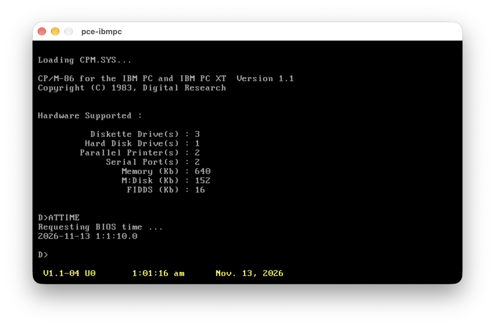
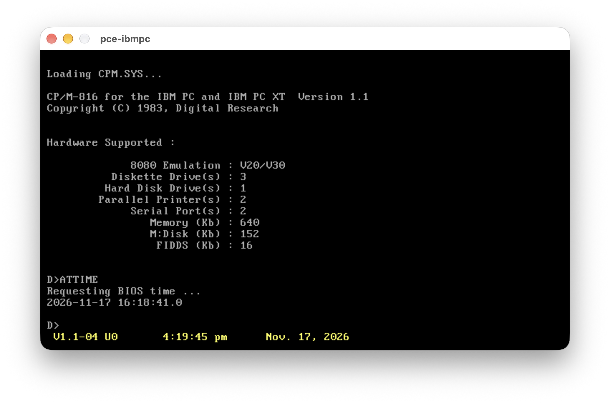
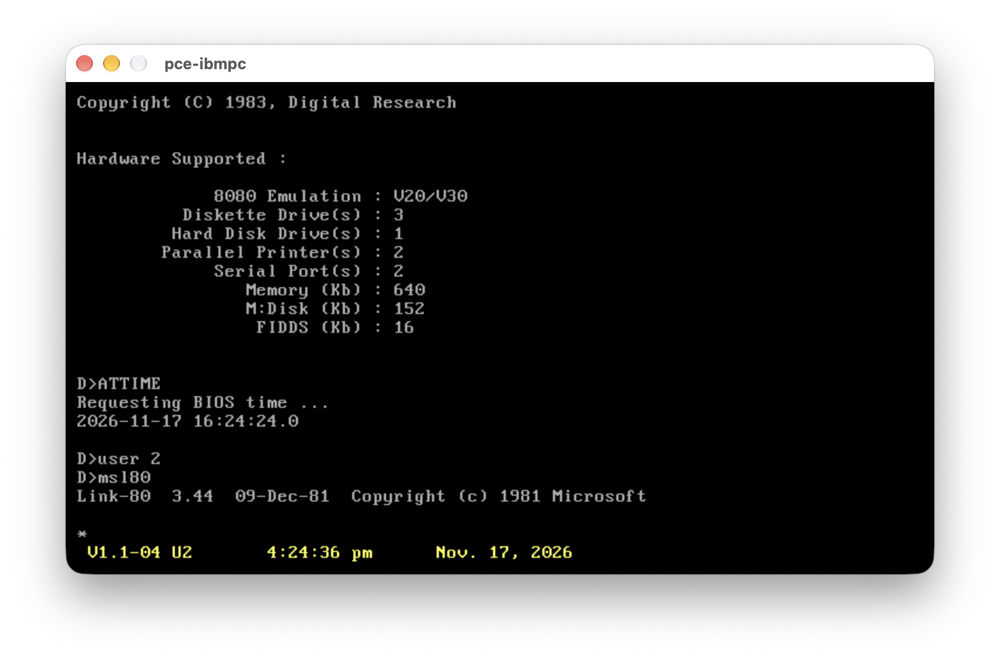
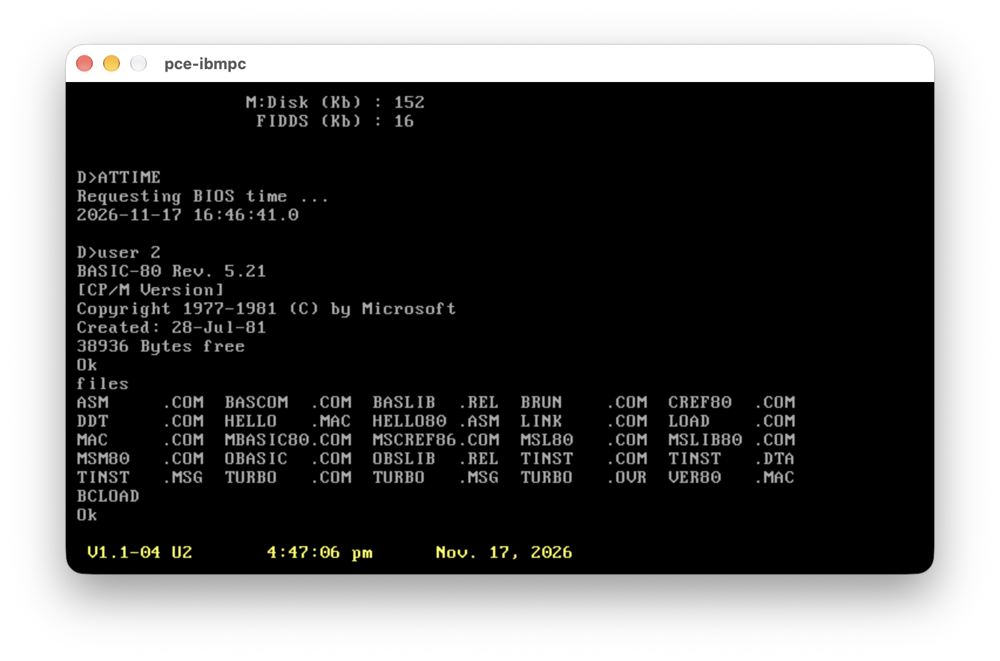
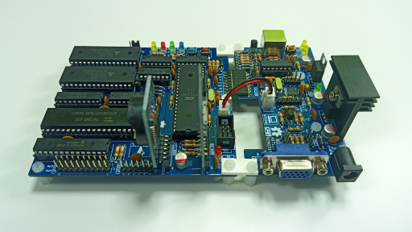
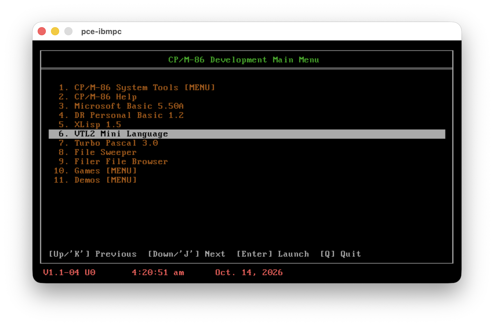
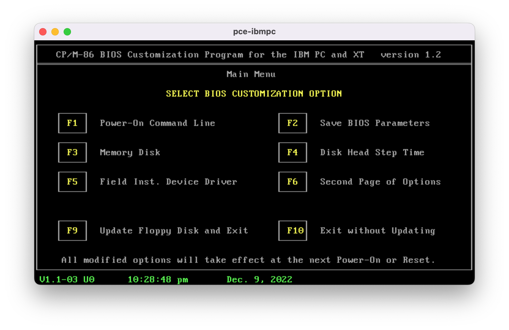
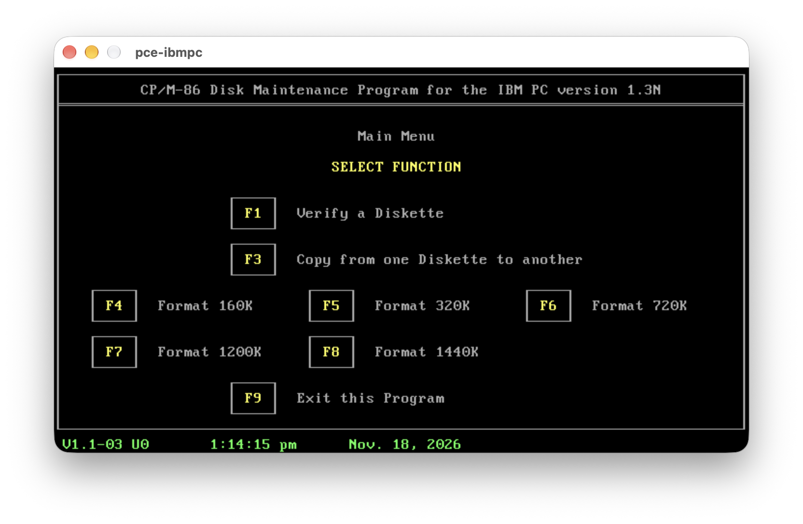

# CP/M-86 and CP/M-816 Kernels and Base Tools

CP/M-86 and CP/M-816 1.1 kernels and commands for IBM PC/XT, emulators, V20 MBC and the AD8088 Card for Apple II. The project contains a full distribution of CP/M-86 1.1, patched, y2k compliant, enhanced and complete, for PC and PC XT built entirely from source.

The CP/M-86 cross development toolkit [cpm86-crossdev](https://github.com/tsupplis/cpm86-crossdev) is used for building kernels, tools and distribution.

| Goal | Distribution |
| --- | --- |
| **Full Source**-built system | Reconstructed PC kernel and maintained commands + extensions and backports from CCP/M-86, with frozen references and all documented patches |
| **CP/M-816** | Native CP/M-86 CMD and 8080 CP/M-80 2.2 COM programs on V20/V30; standard CP/M-86 kernel remains available. you can use the PCE derived emulator [PCE 286](https://github.com/tsupplis/pce-286) for v20/v30 emulation on development/unix host |
| Development tools | DR development chain, DR & Microsoft BASIC, native ASM80/HEXCOM and a separate CP/M-80 tools disk |
| **Y2K** fixes | Correct year-2000 leap handling, optional BIOS RTC date initialization and a 1980–2079 display window |
| Usability and bug fixes | Enhanced SUBMIT, configuration tools, disk maintenance and filesystem checking |
| Storage | 320K distributions, 720K/1.44M support through **144FEAT**, and CP/M hard-disk volumes up to **31.5 MiB** (Native Replacement for CVV) |
| Coherent Ecosystem | Z80 software emulation or VCPM hardware 8080 execution with normal CP/M-86, from [cpm86-ports](https://github.com/tsupplis/cpm86-ports/tree/main/cpu). See for other sister projects at the end of this document |

<p align="center">


<br><sub>CP/M-86 &nbsp;·&nbsp; CP/M-816 on V20/V30</sub><br>


<br><sub>Microsoft LINK-80 &nbsp;·&nbsp; Microsoft BASIC-80 (CP/M 2.2 programs)</sub>
</p>

## Kernels

### Kernel source sets

On NEC V20/V30 PCs, the `cpmexp` configuration becomes **CP/M-816**: native CP/M-86 `.CMD` applications and 8080 CP/M-80 2.2 `.COM` applications on the same system. **No Z80 instruction support.**. All credits to the MBC contributors for the implementation of 8080 functionality ported to IBM-PC.

The PC kernel was recovered by disassembly. Maintained and experimental builds have separate baselines; they intentionally differ from the frozen reference.

| Output | CCP / BDOS / BIOS sources | Purpose |
| --- | --- | --- |
| `cpm.sys` | `ccp.a86`, `bdos.a86`, `pcbios.a86` | Maintained PC kernel |
| `cpmorg.sys` | `ccporg.a86`, `bdosorg.a86`, `pcbioorg.a86` | Frozen patched reference; do not edit |
| `cpmexp.sys` | `ccpexp.a86`, `bdosexp.a86`, `pcbioexp.a86` | CP/M-816 on V20/V30; CP/M-86 on Intel |
| `mbcv20.sys` | `ccp.a86`, `bdos.a86`, `mbcv20.a86` | V20 MBC, 8088 mode; segment `0040h`; ([source](https://hackaday.io/project/170924-v20-mbc-a-v20-8088-8080-cpu-homebrew-computer)) |
| `mbc816.sys` | `ccp.a86`, `bdos.a86`, `mbc816.a86` | V20 MBC, mixed 8080/8088 mode; segment `0040h`; ([source](https://hackaday.io/project/170924-v20-mbc-a-v20-8088-8080-cpu-homebrew-computer)) |
| `ad88.sys` | `ccp.a86`, `bdos.a86`, `ad88bios.a86` | AD8088 / Apple II; segment `4000h`; ([source](https://github.com/ushicow/ad8088cpm)) |

### CP/M-816 configuration

Use `cpmexp.sys` (installed as `CPM.SYS`) or a `cpm86-exp-*` image. The BIOS
automatically detects NEC V20/V30 support, displays **CP/M-816**, and adds
`8080 Emulation : V20/V30` to the hardware list. Existing filenames and
launchers retain `exp` for compatibility.

| Capability | CP/M-816 |
| --- | --- |
| Native applications | Existing CP/M-86 `.CMD` programs; CMD takes precedence over a same-named COM |
| 8-bit applications | CP/M-80 2.2 `.COM` programs using the Intel 8080 instruction set |
| Z80 applications | Use [Z80.CMD](https://github.com/tsupplis/cpm86-ports/tree/main/cpu#z80--software-emulator) for software emulation; the CP/M-816 bridge supports 8080 only |
| Invocation | Bare program name at the CCP prompt or through SUBMIT; arguments and default FCBs supported |
| Exit | Normal return retains the bank for SAVE; the next program, warm boot or Ctrl-C releases it |
| Memory | One contiguous 64 KiB bank retained for the current/last COM, plus the resident BIOS extension |
| Intel 8088/8086 | Remains CP/M-86; native commands work and COM fallback is disabled |
| Limits | No CP/M Plus API or machine-specific hardware compatibility promised |

The bridge reuses the MBC816 implementation through the existing EXP CCP hook.
It does not change standard `cpm.sys` or the CCP/BDOS sources. Details and
validation are in [the patch record](patching/pc816.txt).

### EXP line editing

EXP supports cursor editing and one-line recall on the PC console, on both
Intel and V20/V30 CPUs. Standard kernels retain their existing input behaviour.

| Key | Action |
| --- | --- |
| Left / Ctrl-A; Right / Ctrl-F | Move left; move right |
| Home; End; Ctrl-B | Beginning; end; toggle beginning/end |
| Backspace / Rubout; Delete / Ctrl-G | Delete left; delete at cursor |
| Ctrl-K; Ctrl-X | Delete to end; delete to beginning |
| Up / Ctrl-W | Recall when empty; otherwise move to end |
| Ctrl-U; Ctrl-R; Ctrl-E | Clear; retype; continue on a new row |
| Ctrl-P | Toggle printer echo |

Recall retains up to 127 characters (128 bytes including its length).
Application Function 10 buffers retain their own limits. Blank/cancelled
lines preserve recall. Non-PC console routing uses the original editor;
raw input and SUBMIT behaviour are unchanged. See [patch details](patching/lineedit.txt).

### Kernel patches

Patch history is in `patching/`; addresses and reserved-space use are in [mapping.md](mapping.md). Fixed interfaces and external consumers are listed in [api.md](api.md). Local edits are marked `Ts:`. Public entry points and existing system-data addresses are preserved.

| DR patch | Area | Fix |
| --- | --- | --- |
| 01 | Chain (`MCHAIN`) | Stop at the terminating zero; store the command length correctly |
| 06 | Search (`DRCOPY`) | Copy directory records to the user's DMA segment |
| 07 | Version (`BDOSB`) | Clear `BH` on return |
| 08 | Load (`MLOADP`, `MLOADK`) | Preserve the FCB offset and segment; prevent memory corruption |
| 10 | Dispatch (`BDOSBC`) | Return `FFFFh` for invalid function numbers |
| 11 | Load (`MLOADQ`) | Return `FFFFh` when absolute memory is denied |
| 13 | Internal calls (`PATCH13`) | Preserve `AFWFCB` and `FLOMOD` during loads |
| 15 | Load (`PATCH15`) | Honour absolute data-group bases |

These patches are present in the frozen and maintained BDOS sets. The original PC/XT release lacks patch 15 and places patches 08, 10 and 11 at different addresses. Its free-memory patch at `0A3Ah` is absent here.

| Other change | Effect |
| --- | --- |
| CCP `DIRPAT` | Two-column `DIR` on screens narrower than 60 columns |
| CCP submit handling | Use the current drive; prevent key presses from cancelling submit files |
| Reference IDs | Align OEM, version and serial bytes with the recovered reference |
| Console abort | Match the XT call order in `CONSTA` |
| User 0 system files | Remove the erroneous S1 test in `SRDRNZ`; retain instruction offsets with NOPs |
| PC BIOS | AT interrupt-vector fix, year-2000 fix and 80-column colour fallback |
| PC BIOS RTC date | Standard and EXP read the initial date via `INT 1Ah/AH=04h` when supported. Stock XT or invalid replies retain the default; time initialization and fixed addresses are unchanged. See [mapping](mapping.md#optional-bios-rtc-date). |
| [PC BIOS Y2K leap-year patch](patching/y2kleap.txt) | Standard and EXP recognize year 00 as leap (2000); four-byte in-place fix preserves addresses. The existing four-year rule is not Gregorian century handling for 2100. |
| [PC BIOS displayed century](patching/century.txt) | Display `00–79` as 2000–2079 and `80–99` as 1980–1999. Clock storage and tools are unchanged; all existing addresses are preserved. |
| [EXP line editor](patching/lineedit.txt) | CCP/M-style editing and 127-character recall through Function 10; standard kernel unchanged |
| Maintained PC hard disks | Support partitions up to 31.5 MiB; see [HDMAINT compatibility notes](commands/hdmaint/README.md) |

Tool patches: 03 GENDEF, 04–05 ED, 09 PIP and 12 SUBMIT. Patches 02 (LDCOPY) and 14 (sample BIOS TRACK.A86) are outside this kernel.

## Tools

Original/patched binaries live in `base/`; source builds live in `commands/`. Imported CCP/M commands are adapted for this kernel's BDOS 2.2 interface (`BH=0`).

| Tool | Binary (`base/`) | Source (`commands/`) |
| --- | --- | --- |
| `save` (CP/M-816) | — | `save n filename`: save 0–250 pages of 256 bytes from the last normally returned COM, starting at 0100h; existing files are refused |
| `asm86` | Original | CCP/M-86 3.1 port |
| `assign` | Original | Reconstructed CP/M-86 source |
| `chkcpmfs` | — | New shared PL/M-86 CP/M checker with confirmed metadata repair |
| `config` | Original | Reconstructed CP/M-86 source |
| `dcomp` | — | Compare 160/180/320/360K CP/M or FAT media |
| `dcopy` | — | Copy 160/180/320/360K CP/M or FAT media |
| `ddt86` | Original | CCP/M-86 3.1 port |
| `dform` | — | Command-line formatter using DSKMAINT's boot sector and loader |
| `dskmaint` | Updated 1.0→1.2 | Reconstructed CP/M-86 source |
| `ed` | DR-patched | CCP/M-86 3.1 port |
| `function` | Original | Reconstructed CP/M-86 source |
| `gencmd` | Original | CCP/M-86 3.1 port |
| `gendef` | DR-patched | Adapted from MP/M-86 PL/M sources; CP/M final-record fix; output checked against original |
| `hdmaint` | Updated 1.0→1.2N | Shared maintained formatter; optional MBR preservation |
| `help` | Original | CCP/M-86 3.1 port |
| `help.hlp` | Original | Rebuilt for every core distribution; includes new tools too |
| `mform` | Original | Reconstructed CP/M-86 source |
| `pip` | DR-patched | CCP/M-86 3.1 port |
| `print` | Original | Labelled assembly reconstruction; maintained and frozen builds match the original exactly |
| `setup` | Updated 1.0→1.2 | Reconstructed CP/M-86 source |
| `stat` | Original | Adapted from CP/M-80 2.2 |
| `submit`  | DR-patched | Adapted from CP/M-80 2.2 |
| `tod` | — (superseded) | New, CP/M-86 rewrite |
| `atinit` | Imported from [cpm86-hacking](https://github.com/tsupplis/cpm86-hacking) | — |
| `asm80` | — | Adapted from CP/M-80 2.2 and translated using XLT86 |
| `hexcom` | — | HEXCOM 3.00-compatible C from [tpzasm](https://github.com/johnsonjh/tpzasm) |

[MSUB](https://github.com/tsupplis/cpm86-menu) provides a configurable menu-based and reentrant replacement for SUBMIT.

DCOPY/DCOMP derive from the [PC DOS 1.10 disassemblies](https://github.com/tsupplis/pcdos11-hacking). They detect geometry and accept `[8]` / `[9]` overrides. See [disk tools](commands/disk/README.md).

### Mixed 8080/8086 support

`asm80` (DR CP/M-80 assembler translated with XLT86) and `hexcom` (ANSI C HEXCOM 3.00 reimplementation) provide a native 8080 development chain. [cpm86-ports](https://github.com/tsupplis/cpm86-ports/tree/main/cpu) also offers alternatives requiring no kernel change:

| Tool | Use with normal CP/M-86 or alongside CP/M-816 |
| --- | --- |
| `z80.cmd` | Software 8080/Z80 emulation; no V20/V30 required. Complements CP/M-816 for Z80 programs. |
| `vcpm.cmd` | Hardware 8080 execution on V20/V30 with the normal CP/M-86 kernel; an alternative to integrated CP/M-816. No Z80 instructions. |

### Extended hard-disk sizes

The maintained PC kernels and HDMAINT support new native CP/M partitions beyond the original 8 MiB limit.

| Feature | Support |
| --- | --- |
| Volume size | Variable, including 20 and 30 MiB; up to 31.5 MiB allocation space, less metadata |
| Sizing | Whole cylinders; actual capacity depends on geometry |
| Requirements | Updated kernel and HDMAINT; newly created partition, no in-place migration |
| Interchange | Allocation layout compatible with maintained CCP/M-86 and CDOS 4.1; boot and controller compatibility depend on geometry |

See [HDMAINT](commands/hdmaint/README.md#larger-volumes-and-cdos-compatible-allocation) for limits and format details.

HDMAINT's **F8** selects `replace` (default) or `preserve` for the MBR bootstrap.
It applies to creation, deletion and **F4** boot-partition changes. To renew
only the MBR, select `replace`, then **F4 → F10** without cycling the active partition.

CP/M-86 emulator regressions use `--personality pc` (`cpm.sys`) or
`--personality experimental` (`cpmexp.sys`):

```sh
make -C commands/hdmaint check
python3 tools/hdmaint_live_check.py --emulator pce --personality pc --layout dos-cpm
python3 tools/hdmaint_mbr_check.py --emulator qemu --personality pc --dos-source /path/to/ibm-dos33.img
```

Fixtures use 615/4/17 geometry and 640 KiB RAM (the hard-disk loader uses
`3000:0000`). Repeat with the other emulator/personality. The MBR test exercises both policies,
F4 renewal/switching, cancelled/confirmed deletion and DOS/CP/M hard-disk boots.
The shared HDMAINT notes describe the corresponding CCP/M harness; this project's
scripts use CP/M media and kernels. Fixtures stay in ignored `local/hdmaint-tests/`;
successful runs remove images and retain diagnostics. Manual `--prepare-only`
fixtures are retained until removed after inspection.

### 1.44 MB Feature

Freek Heite's "1.44 MB Feature" adds 720K, 1.2M and 1.44M diskette support. Built from source by `make -C extra` using MASM 5.10 and LINK 5.13 under DOS emulation. The rebuilt `144pat2.cmd` is byte-identical to the binary originally shipped here.

| Output | Role |
| --- | --- |
| `144bldr2.cmd` | Secondary loader; patches the kernel in memory at boot |
| `144pat2.cmd` | Applies the same patches to an already-running system |
| `144prep2.cmd` | Prepares a diskette (boot sector + loader appended) |

### Development toolchains

Included in `dev/`.

| Tool | Product | Version | Vendor |
| --- | --- | --- | --- |
| `rasm86.cmd` | RASM-86 Relocating Assembler | 1.2 | Digital Research |
| `link86.cmd` | LINK86 Linkage Editor | 2.02 | Digital Research |
| `lib86.cmd` | LIB-86 Library Manager | 1.3 | Digital Research |
| `xref86.cmd` | XREF-86 Cross Reference | 1.1 | Digital Research |
| `sid86.cmd` | SID-86 with 286 Disassembler | 2.4 | Digital Research |
| `cbas86.cmd` | CBAS86 CBASIC Compiler | 1.4 | Digital Research |
| `crun86.cmd` | CRUN86 CBASIC Runtime | 1.4 | Digital Research |
| `pbasic.cmd` | Personal BASIC | 1.2N (Supports command line) | Digital Research |
| `mbasic86.cmd` | BASIC-86 (Imported from [cpm86-msbasic](https://github.com/tsupplis/cpm86-msbasic)) | Rev. 5.50 | Microsoft |

### CP/M-80 commands

Included in `cpm80/` and the 320K data disk `cpm86-8080.img` in `disks.zip`.
Run 8080 tools directly with CP/M-816, or through `VCPM` on normal CP/M-86
with V20/V30. For Z80 programs or other CPUs, use `Z80`; see
[Mixed 8080/8086 support](#mixed-80808086-support).
A dash indicates an unverified version; not every program or option has been regression-tested.

| Tool | Product | Version | Vendor |
| --- | --- | --- | --- |
| `asm.com` | CP/M 8080 Assembler | 2.0 | Digital Research |
| `mac.com` | Macro Assembler | 2.0 | Digital Research |
| `ddt.com` | Dynamic Debugging Tool | 2.2 | Digital Research |
| `load.com` | Intel HEX to COM Loader | — | Digital Research |
| `link.com` | Linkage Editor | 1.31 | Digital Research |
| `msm80.com` | Macro-80 Assembler | 3.44 | Microsoft |
| `msl80.com` | LINK-80 Linker | 3.44 | Microsoft |
| `mslib80.com` | Library Manager | —3.44| Microsoft |
| `mbasic80.com` | BASIC-80 Interpreter | 5.21 | Microsoft |
| `bascom.com` | BASIC Compiler | 5.30a | Microsoft |
| `brun.com` | BASIC Runtime | 5.30 | Microsoft |
| `obasic.com` | BASIC Interpreter | 4.51 | Microsoft |

Libraries: `baslib.rel`, `obslib.rel`. Examples: `hello.mac`,
`hello80.asm`, `ver80.mac`.

## Disk images

Images use source-built tools. CP/M-816 configuration images boot `cpmexp.sys` (CP/M-86 on Intel CPUs); other bootable images use `cpm.sys`.

**320K double-sided**

| Image | Contents |
| --- | --- |
| `cpm86-320.img` | Bootable core + assembler tools + DCOPY/DCOMP/DFORM |
| `cpm86-320-at.img` | Same commands, AT-compatible clock |
| `cpm86-exp-320.img` | Core + assembler tools + DCOPY/DCOMP/DFORM, EXP editor and CP/M-816 on V20/V30 |
| `cpm86-exp-320-at.img` | Same commands and AT clock, EXP editor and CP/M-816 on V20/V30 |
| `cpm86-320-dev.img` | Digital Research dev tools + BASIC development |
| `cpm86-8080.img` | Data-only CP/M-80 tools, libraries and examples from `cpm80/` |
| `cpm86-chkcpmfs.img` | Bootable CP/M-86 checker disk with PIP, STAT and CHKCPMFS |

**720K / 1.44M with 144FEAT**

| Image | Contents |
| --- | --- |
| `cpm86-720-at.img` | Full command set including DCOPY/DCOMP/DFORM + dev toolchain, AT-compatible clock |
| `cpm86-1440-at.img` | Same content on 1.44M media |

**CP/M-816 configuration (V20/V30)**

| Image | Contents |
| --- | --- |
| `cpm86-exp-720-at.img` | CP/M-816-capable `cpmexp.sys` + full command set + dev toolchain |
| `cpm86-exp-1440-at.img` | Same content on 1.44M media |

| Image constraint | Detail |
| --- | --- |

PCE launchers: `./cpm86-320`, `./cpm86-720`, `./cpm86-1440`, `./cpm86-exp`, `./cpm86-exp-720`, `./cpm86-exp-1440`. Shortcuts: `make test`, `make test-320`, `make test-exp`.

## cpmtools formats

Use [cpmtools 2.23](https://www.moria.de/~michael/cpmtools/) with libdsk, available through Homebrew. Run it from the repository root to use `./diskdefs`; local definitions replace the system file.

All formats use `os 2.2`. Using `os 3` adds an unwanted CP/M Plus label to the directory.

| Format | Geometry | Block | Dir | Reserved |
| --- | --- | --- | --- | --- |
| `ibmpc-514ss` | 40 × 8 × 512 (160K SS) | 1K | 64 | 1 track |
| `cpm86-320` | 80 × 8 × 512 (320K DS) | 2K | 64 | 1 track |
| `cpm86-720feat` | 160 × 9 × 512 (720K) | 2K | 256 | 2 tracks |
| `cpm86-144feat` | 160 × 18 × 512 (1.44M) | 4K | 256 | 2 tracks |
| `cpm86-xt-hd` | 272 × 63 × 512 (8M partition) | 4K | 2048 | 16 tracks |

| Format note | Detail |
| --- | --- |
| 144FEAT | DPBs are documented in [extra/144tech.md](extra/144tech.md) |
| Hard disk | The table describes one image. BIOS reads each drive's actual parameters from its DR partition label |
| 320K | Head 1 stores cylinders in reverse order. Use `cpm86-320` with `tools/cpm86twist.py`; Makefile image targets handle this automatically. The stock cpmtools `ibmpc-514ds` definition corrupts these raw images |

## Playing with CP/M-86

Use [PCE](http://www.hampa.ch/pce/) with cpmtools for testing, or try the 160K images in QEMU. Hardware option: [V20 MBC](https://hackaday.io/project/170924-v20-mbc-a-v20-8088-8080-cpu-homebrew-computer) ([shop](https://shop.mcjohn.it/en/diy-kit)).

<p align="center">


<br><sub>V20 MBC hardware &nbsp;·&nbsp; CP/M-86 running in PCE</sub><br>


<br><sub>BIOS Setup 1.2 &nbsp;·&nbsp; Disk Maintenance 1.2</sub>
</p>

---

## Companion projects

| Project | Description |
|---------|-------------|
| [cpm86-kernel](https://github.com/tsupplis/cpm86-kernel)     | CP/M-86 1.1 distribution rebuilt from patched and reconstituted sources |
| [ccpm86-kernel](https://github.com/tsupplis/ccpm86-kernel)         | CCP/M-86 3.1 distribution rebuilt from patched and reconstituted sources |
| [cdos41-kernel](https://github.com/tsupplis/cdos41-kernel)         | Concurrent DOS 4.1 distribution rebuilt from patched and reconstituted sources |
| [cpm86-crossdev](https://github.com/tsupplis/cpm86-crossdev) | Unix CP/M-86 cross development project (compilers, emulation and tools) |
| [cpm86-hacking](https://github.com/tsupplis/cpm86-hacking)   | CP/M-86 miscellaneous tools and PCE emulator helpers |
| [cpm86-cmdtools](https://github.com/tsupplis/cpm86-cmdtools) | CP/M-86 `.cmd` file manipulation tools |
| [cpm86-ports](https://github.com/tsupplis/cpm86-ports)       | CP/M-86 application ports in C and assembler |
| [cpm86-vi](https://github.com/tsupplis/cpm86-vi)             | STevie vi port for CP/M-86 and PC-DOS |
| [cpm86-msbasic](https://github.com/tsupplis/cpm86-msbasic)   | A recreation of MSBASIC-86 for CP/M-86 and PC-DOS 1.1 from gwbasic sources |
| [cpm86-menu](https://github.com/tsupplis/cpm86-menu)   | A submit replacement and a menu system for submit orchestration for CP/M-86 1.1 |
| [cpm86-make](https://github.com/tsupplis/cpm86-make)   | A simple submit based make tool for CP/M-86 |
| [pcdos11-hacking](https://github.com/tsupplis/pcdos11-hacking) | PC-DOS 1.1 distribution, tools and notes |

## Pedigree

Primary source: http://www.cpm.z80.de

| Resource | URL |
| --- | --- |
| Baseline sources | http://www.cpm.z80.de/download/cpm86src.zip |
| Dev tools baseline | http://www.cpm.z80.de/download/cpmdev.zip |
| Patch annotations | http://www.cpm.z80.de/download/cpm86ann.zip |
| Bug patches | http://www.cpm.z80.de/download/cpm86bug.zip |
| 144FEAT2 | Freek Heite |
| hexcom | https://github.com/johnsonjh/tpzasm |

## License

CP/M-derived material is covered by the [CP/M license](LICENSE.md); other material uses the [MIT license](LICENSE-bis.md), unless specified otherwise in a subdirectory.
